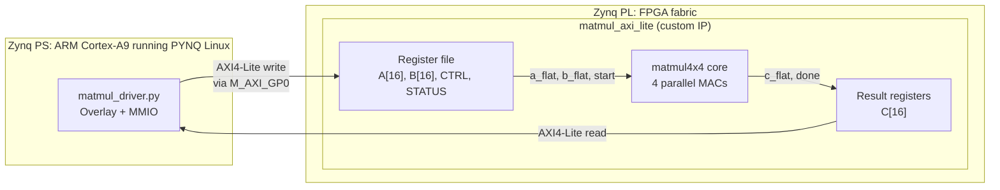
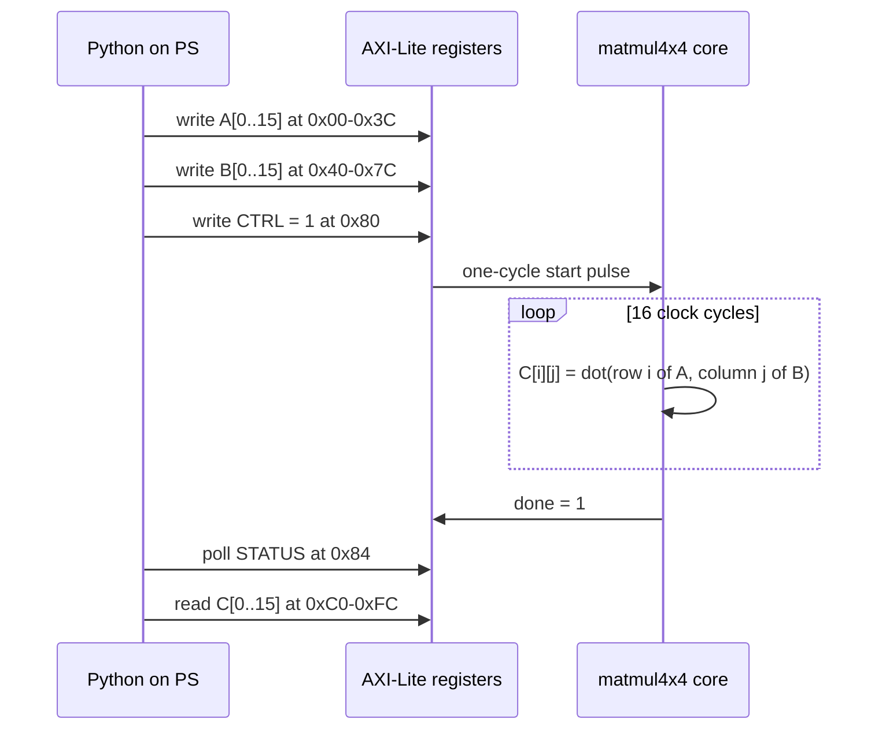
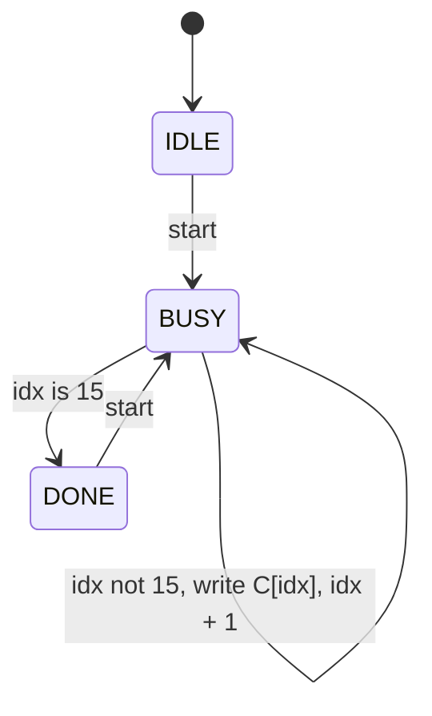

# PYNQ 4×4 Matrix Multiplier: Custom AXI4-Lite IP on Zynq-7000

A Verilog 4×4 signed matrix multiplier, packaged as a Vivado IP with an AXI4-Lite slave
interface and controlled from Python on the **PYNQ-Z2 (Zynq-7020)** through the PYNQ overlay API.
It demonstrates the full hardware-acceleration flow: **RTL → simulation → IP packaging →
block design → bitstream → Python driver on the ARM core**.

> Rebuilt in 2026 after the original source files were lost.

## Architecture



### Transaction flow



### Core control logic



## Register map

| Offset | Name | Access | Description |
|---|---|---|---|
| `0x00–0x3C` | `A[0..15]` | R/W | 16-bit signed, row-major |
| `0x40–0x7C` | `B[0..15]` | R/W | 16-bit signed, row-major |
| `0x80` | `CTRL` | W | bit0 = start |
| `0x84` | `STATUS` | R | bit0 = done, bit1 = busy |
| `0xC0–0xFC` | `C[0..15]` | R | 32-bit signed results |

## Design details
- **Datapath:** each output element is a 4-term dot product computed in one cycle (4 multipliers + adder tree), so a full multiply takes 16 cycles.
- **AXI4-Lite slave:** hand-written write/read channel handshakes. Address and data are accepted together, and the response is issued only after both handshakes complete.
- **Python driver:** packs inputs as 16-bit two's complement, reinterprets results as `int32`, and checks every run against NumPy.

## Repository structure
```
rtl/matmul4x4.v          compute core
rtl/matmul_axi_lite.v    AXI4-Lite wrapper and register file
sim/tb_matmul4x4.v       self-checking testbench
python/matmul_driver.py  PYNQ driver and random self-test
```

## Build and run
```bash
# 1. Simulate (Icarus Verilog or Vivado XSim)
iverilog -o tb sim/tb_matmul4x4.v rtl/matmul4x4.v && vvp tb
```
2. **Vivado → Tools → Create and Package New IP**, add `rtl/*.v`, top = `matmul_axi_lite`. The `S_AXI_*` ports are inferred as an AXI4-Lite interface.
3. Create a new PYNQ-Z2 project → Block Design → add **ZYNQ7 Processing System** → Run Block Automation → add `matmul_axi_lite` → Run Connection Automation → Generate Bitstream.
4. Copy the `.bit` and `.hwh` (from `.gen/sources_1/bd/<bd>/hw_handoff/`) to the board as `matmul.bit` and `matmul.hwh`.
```bash
# 5. On the board
sudo python3 python/matmul_driver.py
```

## Results
<!-- Paste your simulation PASS line, driver output, and a screenshot of the block design -->
| Metric | Value |
|---|---|
| Simulation | <!-- PASS --> |
| Hardware self-test | <!-- 10/10 match NumPy --> |
| Resource usage (LUT / FF / DSP) | <!-- from Vivado utilization report --> |

## Limitations and next steps
- Worst-case inputs (all ±32768) can overflow the 32-bit accumulator.
- `WSTRB` is ignored (PYNQ MMIO always writes full words).
- Next step: an AXI-Stream + DMA version for larger matrices without per-element register writes.

## Tools
Verilog · Vivado · PYNQ · Python · NumPy · PYNQ-Z2 (Zynq-7020)
